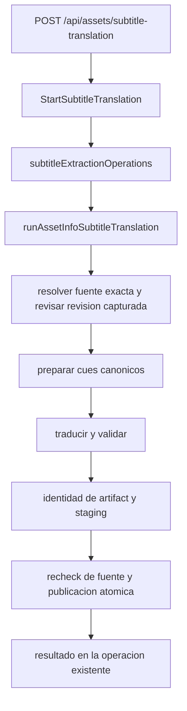
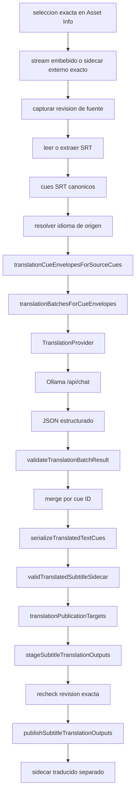
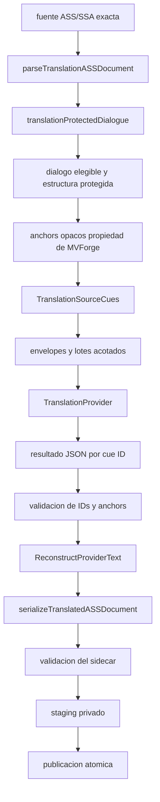
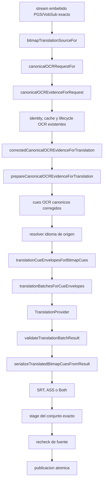
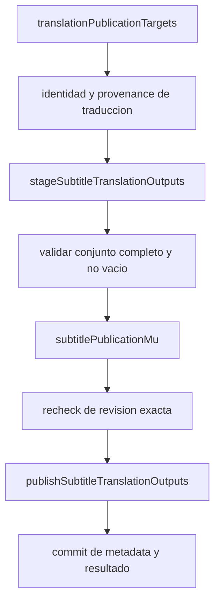

# Arquitectura de traducción de subtítulos

Estado: comportamiento implementado en el código local.

La traducción es una operación explícita de subtítulos desde **Asset Info**.
Reutiliza:

- ownership y revisión exactos de la fuente;
- cues de subtítulos canónicos;
- OCR y corrección canónicos;
- el lifecycle existente de operaciones de subtítulos;
- serializers existentes;
- staging privado de la operación;
- la barrera de publicación atómica existente.

No crea una segunda ruta de Queue, un segundo planner de Track Profiles, otro
lifecycle de OCR, otro sistema de operaciones ni otro publisher.

## Orquestación común

La entrada y la ejecución comparten el modelo de operación de subtítulos:



En términos de ejecución:

```text
resolver fuente exacta
  → verificar revision capturada
  → preparar cues canonicos
  → traducir y validar
  → crear identidad del artifact
  → stagear salidas
  → recheck de fuente
  → publicar atomicamente
  → exponer el resultado
```

Las fases visibles pueden ser `preparing`, `ocr`, `translating`, `validating`,
`publishing` y `cleanup`. La cancelación usa el `context.Context` de la
operación existente. Un retry crea una identidad de operación nueva; no
reactiva el registro terminal anterior.

## Ruta de texto SRT



`executeTextTranslation` coordina los envelopes, los lotes acotados, el
provider, la validación y la serialización. El provider recibe texto
traducible y sus IDs; MVForge conserva los IDs, el orden, los tiempos, la
identidad del artifact, el ownership de la fuente y la publicación.

Puntos de cierre relevantes:

- Auto ambiguo detiene la operación antes de llamar al provider.
- Una respuesta estructurada inválida falla antes de serializar o publicar.
- Una revision obsoleta falla antes de publicar.
- La cancelación limpia el workspace de la operación y no deja publicación
  parcial.

## Ruta protegida ASS/SSA



El texto visible al provider puede combinar diálogo elegible con anchors
opacos propiedad de MVForge. El provider no es dueño de timestamps, nombres de
styles, layer, margins, bloques de override, positioning, drawing mode,
karaoke, controles ni de la estructura `\\N`/`\\n`/`\\h`.

Los helpers principales son `parseTranslationASSDocument`,
`translationProtectedDialogue.TranslatableText`,
`translationProtectedDialogue.ReconstructProviderText`,
`translationASSDocument.TranslationSourceCues` y
`serializeTranslatedASSDocument`.

Cada anchor esperado debe aparecer exactamente una vez y en el orden original.
MVForge rechaza una respuesta que quite, duplique, reordene o invente anchors,
que inyecte bloques ASS de override, escapes estructurales fuera de anchors o
saltos CR/LF físicos prohibidos. Después de validar, reconstruye los bytes
protegidos originales.

Un stream SSA nativo sigue la ruta SSA-aware y produce SSA; no se aplana
silenciosamente a SRT. Esta descripción se refiere al SSA embebido compatible;
la elegibilidad externa V1 de Asset Info continúa limitada a los formatos que
acepta el ownership de sidecars externo.

## Ruta bitmap PGS/VobSub



La traducción no ejecuta su propio Tesseract/SeConv, no posee otra cache OCR y
no repite OCR por serializer. `bitmapTranslationSourceFor`,
`canonicalOCRRequestFor`, `canonicalOCREvidenceForRequest`,
`correctedCanonicalOCREvidenceForTranslation` y
`prepareCanonicalOCREvidenceForTranslation` pertenecen a la frontera
canónica de OCR. La traducción consume la vista final corregida de los cues.

El fallback de orientación `jpn`/`jpn_vert` termina antes del trabajo del
provider. Ollama recibe el idioma y texto canónicos resultantes; no selecciona
la orientación OCR.

Para `Both` hay un único conjunto de cues corregidos y una única transformación
lógica:

```text
un conjunto OCR corregido
  + una traduccion
  → serializer SRT
  → serializer ASS
```

`serializeTranslatedBitmapCuesFromResult` genera las representaciones. SRT y
ASS forman un único conjunto de publicación atómica, no dos ejecuciones OCR o
dos traducciones independientes.

## Frontera común del provider

La implementación V1 usa:

```text
TranslationProvider
  → ollamaTranslationProvider
  → POST /api/chat
```

La solicitud contiene datos acotados: IDs de cues, texto de origen, idioma de
origen, locale de destino y estructuras de contexto acotadas cuando las
proporciona el caller. En Asset Info V1, el contexto está explícitamente
desactivado: `ContextMode = none` y `ContextSource = none`. No se dibuja ni se
ejecuta una consulta TMDB o metadata multimedia en estos flujos.

El provider devuelve IDs de cues y texto traducido. MVForge valida el número
exacto de cues, IDs, orden/ownership, ausencia de faltantes, duplicados o IDs
inesperados y, cuando aplica, la estructura específica de ASS/SSA. El provider
nunca posee timestamps finales ni paths de artifacts.

## Frontera de provider y matriz de soporte

La interfaz común de traducción es text-only y está versionada como
`translation-provider-v1`:

```go
type TranslationProvider interface {
    Translate(
        context.Context,
        TranslationBatch,
    ) (TranslationBatchResult, error)
}
```

El provider sólo recibe texto de subtítulos, idioma de origen, locale de
destino, IDs de cues y contexto acotado cuando el caller lo suministra. Puede
devolver texto traducido y métricas acotadas. MVForge conserva ownership y
revisión de fuente, identidad/orden/timing de cues, estructura protegida
ASS/SSA, geometría/layout, rol y disposición semánticos, identidad de
artifact, validación, serialización, staging, publicación y lifecycle de
cancelación.

El resultado conceptual es:

```text
TranslationBatchResult
  contract version
  translated cues:
    cue ID
    translated text
  optional provider metrics
```

Antes de aceptar el resultado, MVForge exige la versión de contrato, el
conjunto exacto de IDs solicitados, un ID por cue, orden/ownership válido y
ningún cue faltante, duplicado o inesperado. El texto del provider no es
confiable hasta pasar esta validación.

Las clases de error normalizadas por el adapter incluyen `configuration`,
`unavailable`/`transport`, `timeout`, `malformed response` y `cancelled`.
Representan categorías de MVForge y no prometen que todos los proveedores
futuros expongan los mismos códigos de error de vendor.

### Traducción y readiness son interfaces separadas

La traducción normal llama a `TranslationProvider.Translate(...)`. La
comprobación explícita usa la interfaz separada:

```go
type TranslationProviderReadinessChecker interface {
    TestConnection(context.Context) TranslationProviderReadiness
}
```

El lifecycle autorizado es:

```text
configure
  → Test Connection explícito
  → Enable explícito
  → requests normales de traducción
```

La traducción normal no llama automáticamente a `Test Connection` antes de
cada request. Una caída posterior al enablement se reporta como error normal
del provider, no como un loop de preflight.

`translationProviderForSettings(...)` es el seam actual de selección del
adapter y `translationProviderReadinessCheckerForSettings(...)` el seam de
readiness. Ambos construyen actualmente sólo el adapter de Ollama; no existe
plugin discovery dinámico.

| Provider | Translation adapter | Readiness adapter | Configurable en V1 | Estado |
| --- | --- | --- | --- | --- |
| Ollama | Sí | Sí | Sí | Implementado V1 |
| OpenAI | No | No | No | Futuro / no implementado |
| DeepL | No | No | No | Futuro / no implementado |
| Google | No | No | No | Futuro / no implementado |
| Azure | No | No | No | Futuro / no implementado |

La configuración persistida acepta `provider = ollama` o ausencia de provider.
`translationSettingsFromValue(...)` no acepta OpenAI, DeepL, Google o Azure
como providers V1 utilizables. Los identificadores `openai`, `deepl`, `google`
y `azure` son boundaries futuros explícitos: los seams devuelven
`translation provider \"<name>\" is not implemented`.

### Ollama V1

`ollamaTranslationProvider` usa:

```text
POST <configured-endpoint>/api/chat
```

con `model`, `messages`, `stream = false` y `format = json`. La comprobación de
readiness/modelo usa:

```text
POST <configured-endpoint>/api/show
```

El endpoint y el modelo son explícitos; MVForge no infiere localhost. URLs con
credenciales embebidas se rechazan. Ollama V1 no implementa bearer tokens,
API keys ni configuración de credenciales para otros proveedores.

La compatibilidad requiere más que soporte de idiomas: el modelo debe seguir
la instrucción de MVForge y producir JSON con IDs exactos y texto traducido,
sin comentarios o estructura de subtítulo inventada. Ser multilingüe,
especializado en traducción o estar instalado en Ollama no garantiza ese
resultado.

Los estados backend-authoritative de readiness son `disabled`,
`not_configured`, `untested`, `ready`, `unavailable`, `model_not_found` e
`invalid_configuration`. `Ready` no significa `Enabled`: Test Connection puede
dejar el provider ready mientras la traducción continúa deshabilitada. Enable
vuelve a comprobar la configuración actual y sólo habilita tras una comprobación
exitosa. Cambiar provider, endpoint o modelo invalida readiness y enablement;
readiness no es una garantía permanente de salud.

Los adapters futuros, si se implementan, deberán satisfacer el mismo límite:
implementar `TranslationProvider`, traducir sólo texto propiedad del provider,
conservar IDs exactos, devolver resultados estructurados, respetar cancelación,
mapear fallos a las categorías comunes y respetar requests acotados. Su
readiness se integraría mediante `TranslationProviderReadinessChecker` y el
enablement seguiría siendo backend-authoritative. No se prescribe aquí ningún
endpoint, credential format, pricing, rate limit, batching o streaming para
esos providers.

Las métricas comunes pueden registrar provider, modelo, cantidad de requests,
tokens de entrada/salida y latencia cuando el adapter las suministra. Son
datos informativos de auditoría; ningún provider está obligado a exponer
conteos de tokens y MVForge no calcula costos aquí.

MVForge V1 no hace fallback de Ollama a otro provider, no selecciona otro
provider automáticamente, no reintenta contra un segundo provider y no enruta
por idioma del subtítulo. Retry crea otra operación usando la configuración
persistida actual, pero no cambia de provider.

La configuración del provider tampoco agrega política de traducción a Queue,
Track Profiles, Profile Lab o Workers. La frontera de provider sólo se alcanza
desde la operación explícita de traducción de Asset Info.

## Publicación común



Antes de la barrera se validan todas las salidas solicitadas. Para `Both`, una
falla de escritura, validación, metadata, cancelación o source revision
revierte el conjunto y no deja sólo un miembro nuevo. El source recheck ocurre
dentro de la misma barrera de publicación.

### Source revision

Una fuente externa se liga al sidecar exacto y a la evidencia disponible de
ownership y revisión, como path, tamaño, mtime, hash de contenido y clave de
transformación cuando corresponda. Una fuente embebida se liga al snapshot del
media, índice exacto del stream, stream ID/firma y codec/representación. No se
requiere hashear siempre el media completo.

La revisión se captura antes del trabajo del provider y se vuelve a comprobar
inmediatamente antes de publicar. Si cambió, la operación falla cerrada y no
publica un artifact nuevo.

### Identity, naming y metadata

La identidad traducida incluye, como mínimo, versión del contrato, identidad de
artifact/stream de origen, revisión, representación/provenance, idioma
solicitado y efectivo, locale de destino, provider/model/contrato, contrato y
modo de contexto, y representación de salida. Una identidad `es-419` no puede
satisfacer una identidad `es-ES`, y una revisión vieja no puede satisfacer una
traducción de la fuente nueva.

El artifact publicado conserva el locale destino en `artifact.Language`, pero
el componente de idioma usado por el naming es el idioma de la fuente:

```text
source:     Movie.eng.forced.sdh.ass
target:     es-419
translated: Movie.es-419.eng.forced.sdh.ass
```

Esta separación evita `Movie.es-419.es-419...` y conserva el naming canónico de
disposición y rol. El artifact mantiene, cuando aplica, `Default`,
`SourceForced`, `EffectiveForced` como `Forced`, `Role`, `RoleProvenance`,
`RoleConfidence`, `RoleClassifierVersion` y `Title`, con `Mode = translation`
y metadata de identidad/provenance exacta.

## Aislamiento de operaciones y cleanup

La invocación del provider sólo es alcanzable mediante la operación explícita
de traducción. Queue, Track Profile, Profile Lab y el track plan congelado del
Worker continúan usando `ResolvedTrackPlan`; activar la configuración de
traducción no fabrica sidecars traducidos en esos flujos.

El workspace privado pertenece a la operación de traducción y se limpia tras
cancelación o fallo. No forma parte de ese ownership incidental:

- el media de origen;
- los sidecars existentes;
- traducciones previamente publicadas;
- la evidencia OCR canónica compartida.

## Límites de error

| Frontera | Comportamiento de fallo |
| --- | --- |
| Resolución de fuente | La operación no inicia o no continúa. |
| Auto ambiguo | El provider no se llama. |
| OCR o corrección | El provider no se llama. |
| Provider no disponible o timeout | No hay publicación. |
| Respuesta de cues malformada | No hay publicación. |
| Mutación de estructura ASS/SSA | No hay publicación. |
| Source stale | No hay publicación. |
| Validación de salida | No hay publicación. |
| Falla de publicación multi-output | Rollback y ningún conjunto nuevo parcial. |
| Cancelación antes del commit | Cleanup y ningún artifact nuevo. |

## Referencias de implementación

- `backend/internal/handlers/translation_asset_info.go`
- `backend/internal/handlers/translation_cue_envelope.go`
- `backend/internal/handlers/translation_batching.go`
- `backend/internal/handlers/translation_validation.go`
- `backend/internal/handlers/translation_ass_structure.go`
- `backend/internal/handlers/translation_bitmap_source.go`
- `backend/internal/handlers/translation_bitmap_execution.go`
- `backend/internal/handlers/translation_output.go`
- `backend/internal/handlers/translation_publication.go`
- `backend/internal/handlers/translation_artifact.go`
- `backend/internal/handlers/translation_revision.go`
- `backend/internal/handlers/translation_ollama.go`
- `backend/internal/handlers/subtitle_operation.go`


## Follow-up: media context as optional enrichment

The current V1 implementation does **not** enrich Asset Info translation with
media metadata. It reports media context as unavailable/none. Follow-up work
(#107 and #108) will add this without changing translation eligibility.

The design rule is:

```text
media metadata available
  → use bounded media context + neighboring cues

media metadata unavailable / ambiguous / stale
  → continue translation with neighboring cues only
```

Media context is a translation quality enhancement. It is never a requirement
for SRT/ASS/SSA/PGS/VobSub translation.

This is important for RAW-first installations, where an asset may not yet be
known to Jellyfin/Plex and may not have adjacent metadata files:

```text
RAW
  → no NFO
  → no Jellyfin/Plex item
  → no confirmed external provider match
  → translation remains available
```

MVForge must also support Library-first installations where assets already live
in a media-server Library. The metadata resolver must work in either workflow;
the product must not remove RAW merely to make metadata lookup easier.

### Canonical metadata sources

Follow-up #107 owns a canonical MediaMetadata resolver. Translation must consume
that canonical result and must not call Jellyfin, Plex or TMDB directly.

Planned sources include:

```text
Local NFO
Jellyfin API
Plex API
TMDB
future providers
```

Local NFO is a first-class source. Jellyfin can read/write NFO metadata for
movies, shows, seasons and episodes. Common Jellyfin-compatible names include
`movie.nfo`, `tvshow.nfo`, `season.nfo` and an episode's
`<filename>.nfo`. NFO metadata can also carry provider IDs such as TMDB, TVDB
and IMDb.

### Matching and ambiguity

Metadata must never be silently guessed from title similarity alone.

The canonical metadata resolver should expose bounded states such as:

```text
resolved
needs_confirmation
ambiguous
not_found
unavailable
stale
```

Stable evidence such as an external provider ID, exact adjacent NFO, explicit
canonical link or exact series/season/episode identity may resolve
automatically.

Search-based or conflicting candidates require explicit confirmation. The
Translate dialog should not implement its own matcher. It should reuse the
canonical candidate picker from #107.

A compact interaction is preferred:

```text
Media context (optional)

✓ Samurai Champloo · S01E01
  Local NFO
  [ Change ]
```

or, when unresolved:

```text
Media context (optional)

3 possible matches
[ Choose ]   [ Translate without context ]
```

The user must always be able to continue without media context.

Once the user selects a match, that selection belongs to canonical Asset/media
identity and provenance so Advisor, reports and future operations can reuse it.

### TMDB credentials

A direct TMDB integration is opt-in and requires application credentials
created by the user. When implemented, Settings must support the authentication
form chosen by the adapter (TMDB v3 API key or API Read Access Token/Bearer
token) and must keep credentials out of logs, reports, profile snapshots and
translation prompts.

Translation receives only bounded canonical media fields; it never receives
TMDB/Jellyfin/Plex credentials or raw provider payloads.
