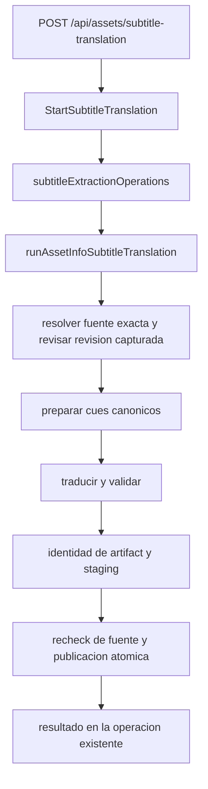
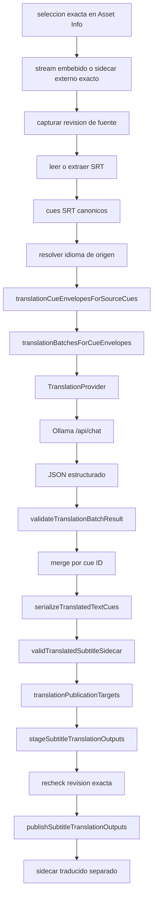
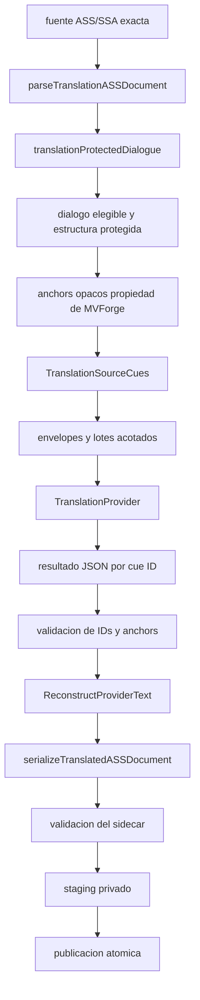
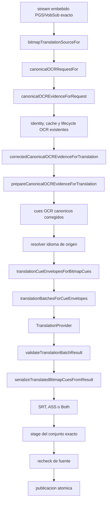
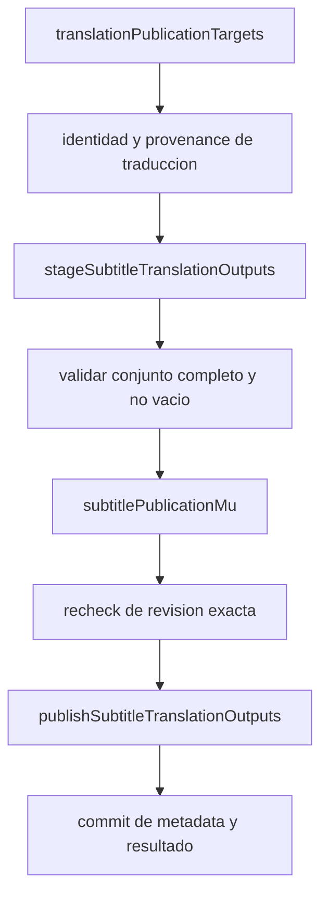

# Arquitectura de traducción de subtítulos

Estado: comportamiento implementado en el código local.

La traducción es una operación explícita de subtítulos desde **Asset Info**.
Reutiliza:

- ownership y revisión exactos de la fuente;
- cues de subtítulos canónicos;
- OCR y corrección canónicos;
- el lifecycle existente de operaciones de subtítulos;
- serializers existentes;
- staging privado de la operación;
- la barrera de publicación atómica existente.

No crea una segunda ruta de Queue, un segundo planner de Track Profiles, otro
lifecycle de OCR, otro sistema de operaciones ni otro publisher.

## Orquestación común

La entrada y la ejecución comparten el modelo de operación de subtítulos:



En términos de ejecución:

```text
resolver fuente exacta
  → verificar revision capturada
  → preparar cues canonicos
  → traducir y validar
  → crear identidad del artifact
  → stagear salidas
  → recheck de fuente
  → publicar atomicamente
  → exponer el resultado
```

Las fases visibles pueden ser `preparing`, `ocr`, `translating`, `validating`,
`publishing` y `cleanup`. La cancelación usa el `context.Context` de la
operación existente. Un retry crea una identidad de operación nueva; no
reactiva el registro terminal anterior.

## Ruta de texto SRT



`executeTextTranslation` coordina los envelopes, los lotes acotados, el
provider, la validación y la serialización. El provider recibe texto
traducible y sus IDs; MVForge conserva los IDs, el orden, los tiempos, la
identidad del artifact, el ownership de la fuente y la publicación.

Puntos de cierre relevantes:

- Auto ambiguo detiene la operación antes de llamar al provider.
- Una respuesta estructurada inválida falla antes de serializar o publicar.
- Una revision obsoleta falla antes de publicar.
- La cancelación limpia el workspace de la operación y no deja publicación
  parcial.

## Ruta protegida ASS/SSA



El texto visible al provider puede combinar diálogo elegible con anchors
opacos propiedad de MVForge. El provider no es dueño de timestamps, nombres de
styles, layer, margins, bloques de override, positioning, drawing mode,
karaoke, controles ni de la estructura `\\N`/`\\n`/`\\h`.

Los helpers principales son `parseTranslationASSDocument`,
`translationProtectedDialogue.TranslatableText`,
`translationProtectedDialogue.ReconstructProviderText`,
`translationASSDocument.TranslationSourceCues` y
`serializeTranslatedASSDocument`.

Cada anchor esperado debe aparecer exactamente una vez y en el orden original.
MVForge rechaza una respuesta que quite, duplique, reordene o invente anchors,
que inyecte bloques ASS de override, escapes estructurales fuera de anchors o
saltos CR/LF físicos prohibidos. Después de validar, reconstruye los bytes
protegidos originales.

Un stream SSA nativo sigue la ruta SSA-aware y produce SSA; no se aplana
silenciosamente a SRT. Esta descripción se refiere al SSA embebido compatible;
la elegibilidad externa V1 de Asset Info continúa limitada a los formatos que
acepta el ownership de sidecars externo.

## Ruta bitmap PGS/VobSub



La traducción no ejecuta su propio Tesseract/SeConv, no posee otra cache OCR y
no repite OCR por serializer. `bitmapTranslationSourceFor`,
`canonicalOCRRequestFor`, `canonicalOCREvidenceForRequest`,
`correctedCanonicalOCREvidenceForTranslation` y
`prepareCanonicalOCREvidenceForTranslation` pertenecen a la frontera
canónica de OCR. La traducción consume la vista final corregida de los cues.

El fallback de orientación `jpn`/`jpn_vert` termina antes del trabajo del
provider. Ollama recibe el idioma y texto canónicos resultantes; no selecciona
la orientación OCR.

Para `Both` hay un único conjunto de cues corregidos y una única transformación
lógica:

```text
un conjunto OCR corregido
  + una traduccion
  → serializer SRT
  → serializer ASS
```

`serializeTranslatedBitmapCuesFromResult` genera las representaciones. SRT y
ASS forman un único conjunto de publicación atómica, no dos ejecuciones OCR o
dos traducciones independientes.

## Frontera común del provider

La implementación V1 usa:

```text
TranslationProvider
  → ollamaTranslationProvider
  → POST /api/chat
```

La solicitud contiene datos acotados: IDs de cues, texto de origen, idioma de
origen, locale de destino y estructuras de contexto acotadas cuando las
proporciona el caller. En Asset Info V1, el contexto está explícitamente
desactivado: `ContextMode = none` y `ContextSource = none`. No se dibuja ni se
ejecuta una consulta TMDB o metadata multimedia en estos flujos.

El provider devuelve IDs de cues y texto traducido. MVForge valida el número
exacto de cues, IDs, orden/ownership, ausencia de faltantes, duplicados o IDs
inesperados y, cuando aplica, la estructura específica de ASS/SSA. El provider
nunca posee timestamps finales ni paths de artifacts.

## Publicación común



Antes de la barrera se validan todas las salidas solicitadas. Para `Both`, una
falla de escritura, validación, metadata, cancelación o source revision
revierte el conjunto y no deja sólo un miembro nuevo. El source recheck ocurre
dentro de la misma barrera de publicación.

### Source revision

Una fuente externa se liga al sidecar exacto y a la evidencia disponible de
ownership y revisión, como path, tamaño, mtime, hash de contenido y clave de
transformación cuando corresponda. Una fuente embebida se liga al snapshot del
media, índice exacto del stream, stream ID/firma y codec/representación. No se
requiere hashear siempre el media completo.

La revisión se captura antes del trabajo del provider y se vuelve a comprobar
inmediatamente antes de publicar. Si cambió, la operación falla cerrada y no
publica un artifact nuevo.

### Identity, naming y metadata

La identidad traducida incluye, como mínimo, versión del contrato, identidad de
artifact/stream de origen, revisión, representación/provenance, idioma
solicitado y efectivo, locale de destino, provider/model/contrato, contrato y
modo de contexto, y representación de salida. Una identidad `es-419` no puede
satisfacer una identidad `es-ES`, y una revisión vieja no puede satisfacer una
traducción de la fuente nueva.

El artifact publicado conserva el locale destino en `artifact.Language`, pero
el componente de idioma usado por el naming es el idioma de la fuente:

```text
source:     Movie.eng.forced.sdh.ass
target:     es-419
translated: Movie.es-419.eng.forced.sdh.ass
```

Esta separación evita `Movie.es-419.es-419...` y conserva el naming canónico de
disposición y rol. El artifact mantiene, cuando aplica, `Default`,
`SourceForced`, `EffectiveForced` como `Forced`, `Role`, `RoleProvenance`,
`RoleConfidence`, `RoleClassifierVersion` y `Title`, con `Mode = translation`
y metadata de identidad/provenance exacta.

## Aislamiento de operaciones y cleanup

La invocación del provider sólo es alcanzable mediante la operación explícita
de traducción. Queue, Track Profile, Profile Lab y el track plan congelado del
Worker continúan usando `ResolvedTrackPlan`; activar la configuración de
traducción no fabrica sidecars traducidos en esos flujos.

El workspace privado pertenece a la operación de traducción y se limpia tras
cancelación o fallo. No forma parte de ese ownership incidental:

- el media de origen;
- los sidecars existentes;
- traducciones previamente publicadas;
- la evidencia OCR canónica compartida.

## Límites de error

| Frontera | Comportamiento de fallo |
| --- | --- |
| Resolución de fuente | La operación no inicia o no continúa. |
| Auto ambiguo | El provider no se llama. |
| OCR o corrección | El provider no se llama. |
| Provider no disponible o timeout | No hay publicación. |
| Respuesta de cues malformada | No hay publicación. |
| Mutación de estructura ASS/SSA | No hay publicación. |
| Source stale | No hay publicación. |
| Validación de salida | No hay publicación. |
| Falla de publicación multi-output | Rollback y ningún conjunto nuevo parcial. |
| Cancelación antes del commit | Cleanup y ningún artifact nuevo. |

## Referencias de implementación

- `backend/internal/handlers/translation_asset_info.go`
- `backend/internal/handlers/translation_cue_envelope.go`
- `backend/internal/handlers/translation_batching.go`
- `backend/internal/handlers/translation_validation.go`
- `backend/internal/handlers/translation_ass_structure.go`
- `backend/internal/handlers/translation_bitmap_source.go`
- `backend/internal/handlers/translation_bitmap_execution.go`
- `backend/internal/handlers/translation_output.go`
- `backend/internal/handlers/translation_publication.go`
- `backend/internal/handlers/translation_artifact.go`
- `backend/internal/handlers/translation_revision.go`
- `backend/internal/handlers/translation_ollama.go`
- `backend/internal/handlers/subtitle_operation.go`
