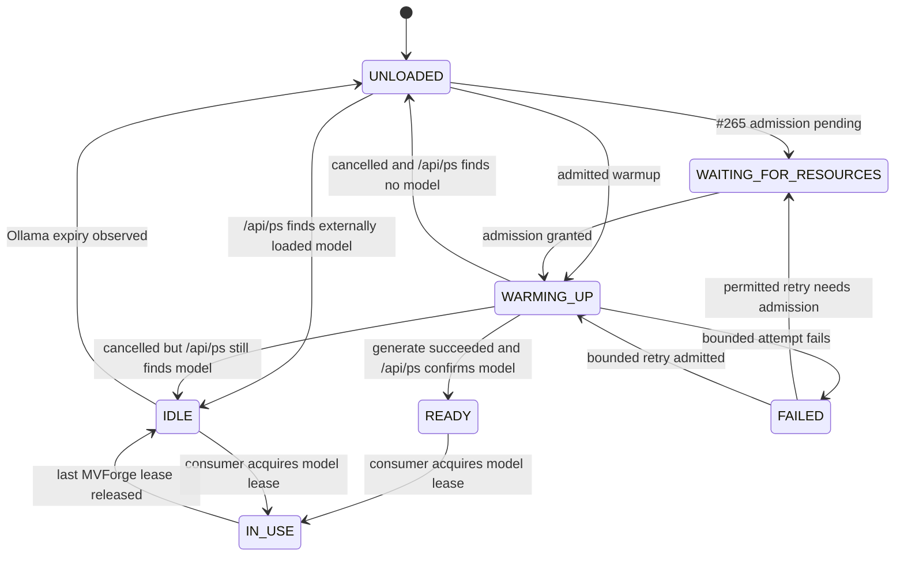

## Context

See [proposal.md](proposal.md) for motivation and scope. The merged #261 shared-provider change owns the canonical Ollama endpoint, installed catalog (`/api/tags`), and metadata readiness (`/api/show`); it deliberately does not own residency, warmup, or inference scheduling. Extend that provider seam for lifecycle calls rather than adding another endpoint resolver or provider record.

Queue already persists `ExecutionPlan.Status` and `WaitingState`; the planner reevaluates waiting plans and the worker claim path activates a reservation and changes the Queue job to running. A model wait therefore belongs before an active FFmpeg reservation or at a checkpoint that has released it. Translation already captures a bounded operation request with exact model and source revision and rechecks source revision before atomic publication, but `subtitleExtractionOperations` is currently process-local. Host `RuntimeState` and immutable `RuntimeSnapshot` describe hardware and encoder environment, not Ollama model residency.

The Ollama API supports an optional prompt, a `keep_alive` request field on both generate and chat operations, and `/api/ps` fields for running model identity and expiry. See the [generate API](https://docs.ollama.com/api/generate), [chat API](https://docs.ollama.com/api/chat), and [running models API](https://docs.ollama.com/api/ps).

## Goals / Non-Goals

**Goals:**

- Give all MVForge AI consumers one on-demand lifecycle manager while keeping each consumer's operation and provenance authority intact.
- Report installed, resident, and MVForge-in-use models from their respective canonical sources.
- Make readiness waits bounded and cancellable, and resume only from a persisted pre-inference checkpoint whose source, model, and cancellation state still match.
- Keep Queue model waits out of FFmpeg reservations and preserve normal scheduling for unrelated jobs.
- Keep runtime and settings integration backend-authoritative and bounded for a resource-constrained NAS.

**Non-Goals:**

- Replacing #261 provider configuration/catalog/readiness or changing model-role/fallback policy owned by #223.
- Implementing resource admission thresholds, inference concurrency policy, or resource priority owned by #265.
- Implementing the #266 Settings UI, or the feature workflows owned by #224 and #263.
- Pulling models, managing Ollama configuration, restarting its container, or force-unloading a model.

## Decisions

### Keep provider transport in the #261 owner

Extend the #261 provider adapter with bounded `POST /api/generate` warmup and `GET /api/ps` residency operations. Reuse its endpoint validation, request context, HTTP client, timeout, bounded body handling, sanitized error classification, and shared endpoint lookup. The existing Translation provider remains responsible for its `/api/chat` cue contract; its request carries the lifecycle keep-alive value through the same shared provider transport. The lifecycle manager receives an exact model ID and provider identity and never persists an endpoint or chooses a model.

The warmup body contains the selected model, omits `prompt`, sets `stream:false`, and supplies `keep_alive`. A bounded successful response plus an exact matching `/api/ps` entry is required before the manager treats an unloaded model as ready. An installed catalog entry or `/api/show` success alone is insufficient. No prompt, source cue, response text, or raw Ollama error body enters lifecycle records or status responses.

**Alternative rejected:** add a lifecycle-owned Ollama client or endpoint setting. That would create a second connection authority and diverge from #261's network and diagnostic bounds.

### Treat residency as a projection and busy as MVForge operation state

Keep the lifecycle state set in the proposal. `UNLOADED` means no matching `/api/ps` entry; `WAITING_FOR_RESOURCES` reflects a denial/queue result from #265; `WARMING_UP` means one admitted shared warmup is active; `READY` means a successful warmup is handing the model to its first waiting consumer; `IN_USE` comes from an active MVForge operation lease; `IDLE` means a resident model has no active MVForge lease; and `FAILED` records a bounded failed attempt. `IDLE` and `/api/ps` residency alone do not claim successful inference readiness. When an external Ollama client changes residency, the next bounded observation reconciles the projection. The API distinguishes an unavailable `/api/ps` response from a valid empty list.

Do not add resident-model rows to `RuntimeState` or `RuntimeSnapshot`: those remain host-environment authorities. The runtime response combines #261 installed models, `/api/ps` residency and expiry, and active MVForge consumer leases. Apply a shared short cache/rate limit to status requests so Settings polling cannot create aggressive Ollama traffic. The #266 UI displays this response; it does not contact Ollama.

**Alternative rejected:** persist a second global model-state machine or infer `IN_USE` from `/api/ps`. A local mirror would become stale when Ollama or external clients change residency, and Ollama cannot identify MVForge ownership.

### Warm just before model work and let Ollama expire idle residency

Request a model only when an explicit operation starts or a Queue model-dependent stage becomes runnable. Do not warm during profile/model saves or while another Queue gate is closed. If `/api/ps` already reports the exact selected model, proceed through the current provider request and renew its `keep_alive`; otherwise, after #265 grants admission, coalesce callers on a key made from shared provider identity and exact model ID, POST the no-prompt warmup, then verify residency. A successful no-prompt warmup uses the official Ollama generate contract; Translation and other inference requests also pass the duration in their request. A loaded-but-not-currently-used model is reported as `IDLE`; the runtime response keeps its residency observation separate from the last readiness evidence.

Default `keep_alive` is 30 minutes. Expose bounded settings choices (5/15/30/60 minutes) and the on-demand warmup toggle through the lifecycle settings contract for #266 to present. At expiry, Ollama is allowed to unload the model. Do not send `keep_alive:0` in this change: shared Ollama may serve other clients and MVForge cannot prove that it owns every loaded model. Resource admission is requested from #265 before warmup; no RAM, VRAM, resident-count, or concurrency policy is copied into the manager.

**Alternative rejected:** start warmup for every queued or newly configured model. This wastes NAS memory and can load work that never becomes runnable.

### Bound readiness, cancellation, and retry at the consumer boundary

Default the readiness window to five minutes, beginning after resource admission so #265's wait remains under its own policy. Within the window, use bounded attempts and backoff; default timeout action is a retryable failure with no further automatic attempt. #266 may expose bounded timeout choices (2/5/10 minutes) and `retry`/`fail` policy, but any automatic retry remains finite and idempotent at the warmup boundary. `/api/ps` polling is rate-limited and deadline-bound. A missing model, provider error, invalid response, timeout, and cancellation produce different bounded outcomes.

Singleflight waiters have independent cancellation. Cancelling one waiter does not cancel warmup still needed by another; when the final waiter leaves, cancel the shared request context. Since Ollama may finish loading after a client disconnect, reconcile `/api/ps` before retrying or reporting the model unloaded. Cancellation always wins before a consumer resumes.

**Alternative rejected:** retry forever or treat client disconnect as proof the provider operation stopped. Either can create an infinite queue spinner or duplicate/overlapping model loads.

### Use workflow-owned checkpoints for durable waits

For Queue, persist `WAITING_FOR_MODEL` in the existing execution plan and store the exact model selection, source revision, consumer stage, and wait deadline in a bounded plan checkpoint. Enter this state only after the plan is otherwise runnable; do not activate an FFmpeg reservation while waiting. The model wait must not block another ready Queue plan. On readiness or restart recovery, re-read the Queue job and checkpoint atomically, verify cancellation and the frozen source/model identities, then return through normal claim and reservation. If a claimed worker reaches a model boundary, it must checkpoint completed work and release its reservation before waiting; it must not replay already completed stages after resume.

For Translation, extend its existing operation lifecycle with a minimal durable operation record for wait/recovery metadata. Persist operation ID, phase, selected model, source identity/revision, cancellation/terminal state, and publication-commit marker; do not persist cues, prompts, responses, or generated translation payloads in the wait record. The in-memory operation map becomes a cache of this owner-controlled record. Startup resumes the same operation only at a pre-inference `WAITING_FOR_MODEL` boundary after source/model/cancellation checks. If a crash leaves an inference outcome uncertain, mark the attempt retryable and do not replay it; the existing explicit retry contract creates a new operation identity. The existing all-output publication transaction must persist its commit marker atomically so recovery cannot publish a duplicate result.

OCR and Copilot integrations use the same manager interface but keep checkpoints in their feature-owned operation/workflow state when #263 and #224 integrate it. The lifecycle manager stores no consumer payload or parallel task state.

**Alternative rejected:** store all consumers' operations in a new generic manager queue. That would create another workflow authority and duplicate Queue/Subtitle operation state.

### Keep model roles, resource decisions, and Settings presentation with their owners

Resolve the exact model before calling the lifecycle manager: #223 owns Primary/Fast/Fallback and eligible fallback; #266 owns feature model selection. A fallback is a new explicit consumer request only when the role policy chooses it. A model-setting or endpoint change does not rewrite an already frozen Queue/Translation checkpoint; it invalidates a wait only when its stored provider/model identity is no longer usable under the owning workflow's snapshot. #265 alone decides whether a warmup has resource admission and when a resource-waiting request can retry.

The backend exposes lifecycle policy and runtime status to #266 without owning its screen layout or unsaved-draft behavior. Keep provider connectivity, per-model metadata readiness, loaded residency, and inference use as separate status fields.

**Alternative rejected:** let the manager silently select a fallback or wait past a changed feature selection. That would violate #223/#266 ownership and change frozen execution semantics.

## Risks / Trade-offs

- **Warmup can consume substantial NAS memory and CPU →** call #265 before each model load, admit only runnable work, and stop when readiness expires; #264 does not invent capacity guarantees.
- **The provider may complete warmup after local cancellation →** treat cancellation as authoritative for the consumer and reconcile `/api/ps` before another attempt.
- **Ollama residency can change outside MVForge, and `expires_at` can be renewed by other clients →** report observed state with a timestamp and refresh through bounded `/api/ps`; do not claim exclusive ownership or force eviction.
- **Five minutes may not load a large model on slower hardware →** expose the bounded timeout choices through #266 and return an actionable retryable failure when the selected bound expires.
- **Translation operations are currently process-local →** add only the minimal durable wait checkpoint and commit marker to their existing lifecycle; test restart before inference, during inference, and after publication commit to prevent replay or duplicate artifacts.
- **Warmup failure may be a role-specific fallback opportunity →** return a typed failure to the consumer and let #223 decide whether to try its fallback model.
- **#265 is not yet merged →** lifecycle resource wait integration depends on its admission contract; until that contract exists, do not ship an independent resource policy or claim `WAITING_FOR_RESOURCES` recovery.

## Migration Plan

1. Add the bounded lifecycle policy and workflow checkpoint fields/tables without backfilling model residency; absent checkpoint data means no pending model wait.
2. Deploy the #261 provider extension and lifecycle manager with the existing keep-alive/readiness defaults. No existing Queue item or Translation setting is proactively warmed.
3. Enable Queue and Translation wait checkpoints only when their workflow recovery handlers and #265 admission integration are available. Keep #266 as the presentation and settings client.
4. On rollback, stop creating new waits, preserve existing checkpoints for inspection, and fail them closed as retryable rather than dispatching work without validating their frozen source/model state. Do not delete operation or publication evidence.
